<!--
  Terminal-style profile. Every image lives in /assets and is generated by
  scripts/generate.mjs; a daily GitHub Action keeps the stats fresh (see SETUP.md).
  Each <picture> serves: phone + dark, phone + light, desktop + dark, desktop + light.
-->

  <picture>
    <source media="(max-width: 600px) and (prefers-color-scheme: dark)" srcset="assets/contributions-narrow-dark.svg">
    <source media="(max-width: 600px)" srcset="assets/contributions-narrow-light.svg">
    <source media="(prefers-color-scheme: dark)" srcset="assets/contributions-dark.svg">
    
  </picture>

  <picture>
    <source media="(max-width: 600px) and (prefers-color-scheme: dark)" srcset="assets/whoami-narrow-dark.svg">
    <source media="(max-width: 600px)" srcset="assets/whoami-narrow-light.svg">
    <source media="(prefers-color-scheme: dark)" srcset="assets/whoami-dark.svg">
    
  </picture>

  <a href="https://paypeek.es">
    <picture>
      <source media="(max-width: 600px) and (prefers-color-scheme: dark)" srcset="assets/building-narrow-dark.svg">
      <source media="(max-width: 600px)" srcset="assets/building-narrow-light.svg">
      <source media="(prefers-color-scheme: dark)" srcset="assets/building-dark.svg">
      
    </picture>
  </a>

  <picture>
    <source media="(max-width: 600px) and (prefers-color-scheme: dark)" srcset="assets/projects-narrow-dark.svg">
    <source media="(max-width: 600px)" srcset="assets/projects-narrow-light.svg">
    <source media="(prefers-color-scheme: dark)" srcset="assets/projects-dark.svg">
    
  </picture>

  <picture>
    <source media="(max-width: 600px) and (prefers-color-scheme: dark)" srcset="assets/stack-narrow-dark.svg">
    <source media="(max-width: 600px)" srcset="assets/stack-narrow-light.svg">
    <source media="(prefers-color-scheme: dark)" srcset="assets/stack-dark.svg">
    
  </picture>

  <picture>
    <source media="(max-width: 600px) and (prefers-color-scheme: dark)" srcset="assets/before_university-narrow-dark.svg">
    <source media="(max-width: 600px)" srcset="assets/before_university-narrow-light.svg">
    <source media="(prefers-color-scheme: dark)" srcset="assets/before_university-dark.svg">
    
  </picture>

  <picture>
    <source media="(max-width: 600px) and (prefers-color-scheme: dark)" srcset="assets/contact-narrow-dark.svg">
    <source media="(max-width: 600px)" srcset="assets/contact-narrow-light.svg">
    <source media="(prefers-color-scheme: dark)" srcset="assets/contact-dark.svg">
    
  </picture>

  <a href="https://www.linkedin.com/in/juan-rodriguez-cunef"><code>linkedin</code></a> ·
  <a href="https://paypeek.es"><code>paypeek.es</code></a> ·
  <a href="mailto:juanmaria.rodriguezestrada@gmail.com"><code>email</code></a>

